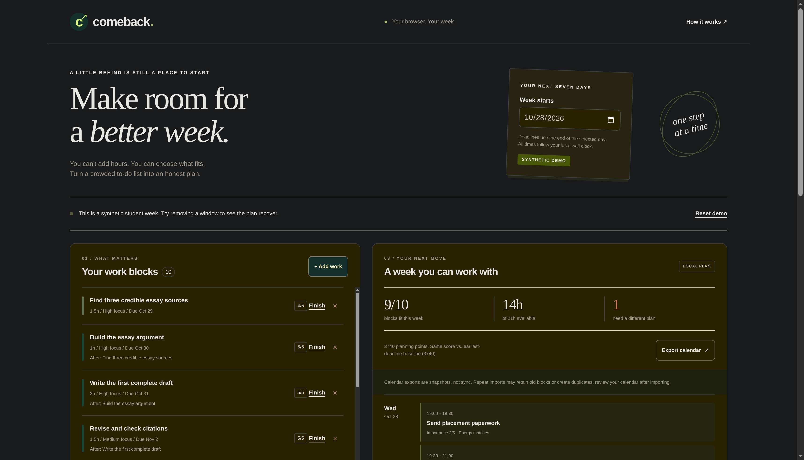
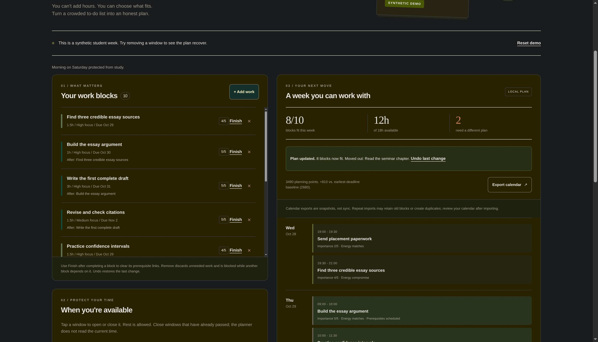
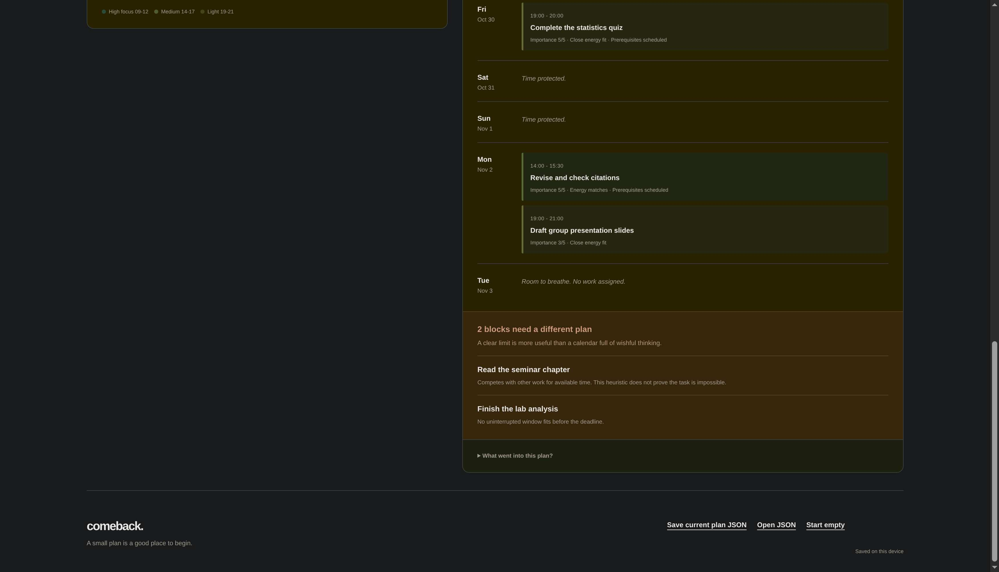
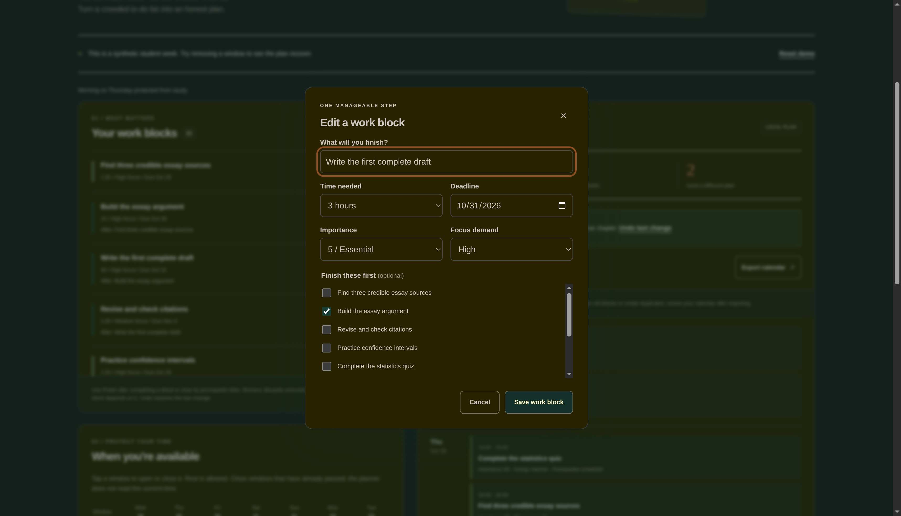

# Comeback

A local student recovery planner for a week with more work than available time.

Add finishable work blocks with durations, deadlines and prerequisites. Mark available study windows. Comeback shows a feasible schedule, explains omitted work, and replans when a window closes. You can undo changes, mark work finished, save a JSON backup and export the schedule to a calendar.



## Run locally

Requires Node.js 20 or later. Extract the downloadable build or clone the source, open its directory in a terminal, and run:

```sh
npm start
```

Open http://127.0.0.1:4179 in a browser on the same computer. Keep the server running while using the app. No package installation, account, API key or network service is needed to run it. If that port is occupied, use `PORT=4180 npm start` and open port 4180 instead.

The initial week is explicitly synthetic. Start empty replaces it with an empty local plan and supports Undo. Data stays in that browser's localStorage; backups contain plain-text task details. Clearing browser data removes the saved plan.

## Try a disruption

In the synthetic example, close Saturday October 31's morning window. The planner schedules eight blocks in the remaining time and reports 3,490 planning points versus 2,680 for its earliest-deadline baseline. The omitted-work list distinguishes a missing uninterrupted window from competition for available time. This is one reproducible example, separate from the fixed benchmark below.





Edit the draft block to inspect its prerequisite. Finish removes a completed block and clears its prerequisite references; Undo restores both. Remove protects work that still has dependents.



## Verification

To install the locked development dependencies and reproduce the checks:

```sh
npm ci
npm run check
```

The runtime app has no npm dependencies. happy-dom is used only for interface tests. The check runs syntax checks, scheduling/DOM/HTTP tests, independent exhaustive oracles, and a seeded benchmark.

The included November 6 log records 51 passing tests and the complete 60-case benchmark. The original oracle covers 40 small single-window cases. An additional independent oracle covers 22 cases with multiple days and windows, differing deadlines and energy, prerequisites, empty availability and completion-time tie-breaking.

The benchmark improves the synthetic planning score over the included earliest-deadline baseline in 51 cases and ties in nine: 244,310 versus 231,220 total points. A gain may reflect energy fit rather than more completed work. The baseline is retained, so zero regressions is a built-in guarantee. These are not measured student outcomes.

Real-browser checks covered replanning, Undo focus restoration, Tab/Space and Escape, prerequisite/cycle errors, finishing, adding, editing, removing, empty/reset states, and JSON/calendar downloads. Downloaded files were inspected against the synthetic task and its scheduled time. The screenshots are genuine unedited desktop captures. The browser applied dark colors; the intended light palette was not separately verified. Narrow/mobile layout, assistive technology, print, reduced-motion behavior, browser file import and importing the ICS into a calendar application remain unverified.

## Scheduling limits

The prototype supports 16 blocks over seven days, with fixed morning, afternoon and evening windows. Every whole block must fit one window and finish by the end of its deadline day. Prerequisites finish first. The search uses a bounded beam and retains the greedy baseline if it scores better; pruned searches are heuristic.

Importance and a fixed energy-fit model determine the score. There are no automatic buffers or live clock adjustments. Arbitrary task splitting changes the objective. Calendar downloads use floating local times and are snapshots, not synchronization; repeated imports may retain old placements. Local storage is not encrypted. Finish removes work from the remaining plan rather than maintaining a completion history.

## Attribution

OpenAI Codex assisted with concept, implementation, styling, tests, debugging and documentation. The initial tasks and benchmarks are synthetic. No AI model or remote AI service is needed to run the app. See ATTRIBUTION.md for implementation and dependency credits.
